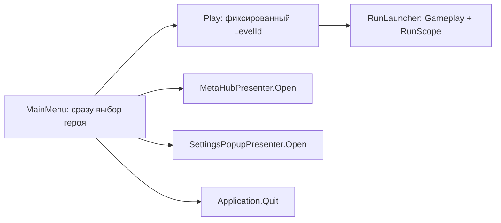
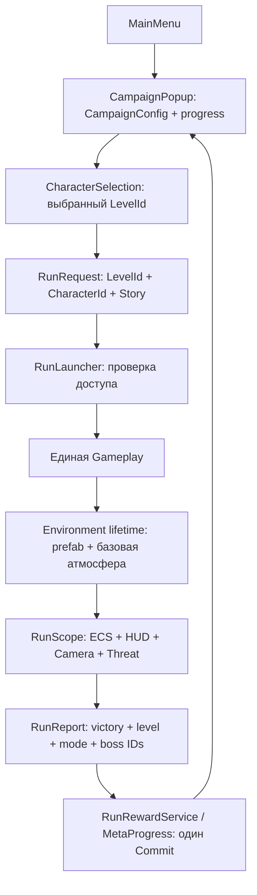

# Campaign & Second Level — техническая разведка

Дата: 2026-11-08. Проект: `D:/Unity/Git/Deman-Slaughter-Survivor`. Язык отчёта — русский.

Обозначения: **CONFIRMED** — непосредственно прочитано в файлах/ответе инструмента; **INFERRED** — вывод или предлагаемое решение; **UNKNOWN** — проверка не выполнена или доказательств недостаточно. Все новые имена ниже — предложения, а не существующие компоненты.

## 1. Executive Summary

**CONFIRMED.** Для двух уровней не требуется второй Gameplay или новый глобальный game manager. Уже существуют `LevelConfig`, `RunRequest.LevelId`, `RunContext`, `RunLauncher`, отдельные таймлайны волн, scoped ECS-мир и сохраняемая мета. Основная работа — расширить данные уровня, навигацию меню, завершение/сохранение и набор атак босса.

**INFERRED.** Рекомендуется сохранить ID первого уровня `level.gameplay`, добавить второй LevelConfig с той же SceneName `Gameplay`, прямой ссылкой на prefab окружения и отдельным таймлайном. Кампанию описать небольшим каталогом двух уровней и prerequisites; хранить завершённые LevelId в существующем meta.json. Блокировку проверять и в UI, и перед запуском.

**CONFIRMED.** DemonLord найден в `Assets/DemonLord2`. Attack1 и Attack2 существуют как состояния контроллера со ссылками на отдельные FBX. Исходный контроллер автоматически переходит Attack1 → Attack2 → Attack3, не содержит параметров; импортированный prefab не имеет игровых MonoBehaviour. Его нельзя просто назначить в EnemyConfig и считать интегрированным.

**UNKNOWN.** Визуальная пригодность атак, точный кадр выброса огня/удара, длительности клипов и встроенные FBX Animation Events не проверены. MCP нестабилен; Play, sampling анимаций, открытие сцен, prefab stage, execute_code и переимпорт не выполнялись.

Прочитаны `AGENTS.md`, `CLAUDE.md`, начало `docs/PROGRESS.md`, относящиеся к задаче разделы `docs/ARCHITECTURE.md`; прежняя разведка использована как карта, выводы ниже сверены с кодом. Создание этого отчёта прямо разрешено задачей и не противоречит AGENTS. Другие файлы в этой сессии не записывались.

## 2. Current Project Architecture

**CONFIRMED.** Unity `6000.4.11f1` (`ProjectSettings/ProjectVersion.txt`), URP — ссылка `m_CustomRenderPipeline` и URP global settings в `ProjectSettings/GraphicsSettings.asset`; версия URP 17.4.0 в Packages/manifest.json. VContainer, LeoECS Lite + DI, UniTask, Input System, R3, Cinemachine, uGUI/TMP и DOTween используются собственным кодом.

| Слой в `Assets/_Project/` | Фактическая роль и точки подключения |
|---|---|
| Core | контракты, ContentRegistry, RunRequest/RunContext/RunReport/RunMode, IRunLauncher, IMetaProgress |
| Configs | ContentDatabase, LevelConfig, EnemyConfig, BossConfig, WaveTimelineConfig; сериализованные данные рядом |
| Bootstrap | ProjectLifetimeScope, BootstrapEntryPoint, RunLauncher, RunLifetimeScope, RunEntryPoint |
| Services | SceneLoader, FileSaveStorage, GameSettings, InputService |
| Simulation | Components, Systems, Services; RunSystems задаёт порядок |
| View | ViewPool, ViewInterpolator, CameraService, ThreatAtmosphere, BossKnightView и VFX |
| UI | MainMenuView, MenuHeroLineup, popup views/presenters, MetaHub, HUD/результаты |
| Meta | MetaProgress, MetaSaveData, MetaSaveSanitizer, MetaLoadoutBuilder, RunRewardService |

**CONFIRMED.** 13 собственных asmdef: восемь runtime, два Editor, три Tests. Основные границы: Simulation → Core/Configs/ECS; UI → Core/Configs; View → Core/Configs; Meta → Core/Configs; Bootstrap объединяет реализации. Полные определения: `Assets/_Project/{Core,Configs,Simulation,UI,View,Meta,Services,Bootstrap}/Game.*.asmdef`. Конфиги ссылаются на Core; UI не должен зависеть непосредственно от Meta-реализации. Новую campaign-read API следует объявлять в Core. Simulation фактически использует UnityEngine и SO-конфиги; формулировка «без Unity API» в архитектурном документе слишком строгая.

**CONFIRMED.** Root prefab подключён через `Bootstrap/VContainerSettings.asset` в preloadedAssets ProjectSettings. ProjectLifetimeScope регистрирует singleton контент, ввод, настройки, мету, сохранение, награды и launcher. `BootstrapEntryPoint.StartAsync` → `SceneLoader.LoadAsync` → MainMenu. SceneLoader использует `SceneManager.LoadSceneAsync(..., Single)`.

`RunLauncher.StartAsync` создаёт RunContext, получает LevelConfig по ID, загружает `level.SceneName`, затем `CreateChild<RunLifetimeScope>` с контекстом/уровнем. RunLifetimeScope регистрирует scoped пул, камеру, threat atmosphere, модели UI и RunEntryPoint. `RunEntryPoint.Initialize` создаёт ECS; Tick выполняет шаг 1/60 с, максимум 5 шагов/кадр. Finish/Restart уничтожают run scope через отложенный destroy barrier. Это подходящий жизненный цикл для окружения.

**CONFIRMED.** Отдельной универсальной state machine в исследованном потоке нет. Сцены переключает launcher; пауза/выбор/finish — флаги RunEntryPoint, RunOutcome и UpgradeChoiceGate. Действия босса — EnemyActionPhase и системы AdvanceEnemy*. Вводить ещё одну state machine приложения ради двух popup не требуется (**INFERRED**).

**CONFIRMED.** Addressables установлен, но поиск `Addressables|Resources.Load|AssetBundle` в собственных `.cs` не дал результатов. ViewPool, CameraService, ThreatAtmosphere создают объекты по прямым prefab-ссылкам. Готового общего асинхронного AssetLoader для окружений не обнаружено. Прямой Instantiate по LevelConfig соответствует текущему проекту; это предложенное расширение, не существующий сервис.

### Git и доступность MCP

**CONFIRMED.** До записи отчёта `git -c safe.directory=D:/Unity/Git/Deman-Slaughter-Survivor --no-optional-locks status --short --branch` показал чистую рабочую копию, ветку `feature/meta-progression...origin/feature/meta-progression`. HEAD `ddc5082e Update AlegreyaSans SDF.asset`. Это отличается от предыдущей разведки: прежние изменения шрифтов больше не присутствуют в status. Fetch не выполнялся, актуальность remote не проверена. Есть предупреждение о недоступном глобальном git ignore; глобальная конфигурация не менялась.

**CONFIRMED.** MCP `custom-tools` вернул 35 инструментов; instances — один редактор `Deman-Slaughter-Survivor@413650bbaa073fb4`. editor/state: Bootstrap, play=false, compiling=false, external_changes_dirty=true, stale_status, ready_for_tools=false. `manage_scene(get_active)` завершился сообщением `Unity plugin session ... disconnected while awaiting command_result`. `read_console(get,error+warning,count=20)` вернул 0 записей. Иерархия Gameplay и live Animator через MCP не получены; сцены не переключались. Пустая Console не доказывает успешную сборку или отсутствие ошибок при запуске. После сбоя основной аудит продолжен по YAML/исходникам.

## 3. Current Main Menu Flow

**CONFIRMED.** Сцена `Assets/_Project/Scenes/MainMenu.unity`; `UI/MainMenuLifetimeScope.Configure` регистрирует MainMenuView из иерархии. `MainMenuView.Start` проверяет назначение Play/Upgrade/Settings/Quit, SettingsPopup и MetaHub, создаёт presenters, вызывает BuildHeroChoice.

`BuildHeroChoice` получает все CharacterConfig из registry, сортирует по MenuOrder/ID, выбирает сохранённого героя через IHeroSelection, затем вызывает `MenuHeroLineup.Build`. `SelectHero` сохраняет выбор через GameSettings в settings.json. Кнопка Play → OnPlayClicked → StartRunAsync → `new RunRequest(_levelId, _characterId, RunMode.Story)` → IRunLauncher.StartAsync. `_levelId` — сериализованное поле MainMenuView, а не пользовательский выбор уровня. `_isStarting` защищает от двойного клика и отключает кнопки/lineup. Quit сейчас сразу вызывает Application.Quit.

**CONFIRMED.** Есть отдельные views/presenters и `UI/UiFade.cs`, но общего popup stack/router в исследованных классах нет. Settings использует `Prefabs/UI/SettingsPopup.prefab`; MetaHubView сериализован в MainMenu, содержимое вкладок строится кодом. `UI/MenuRoute.cs` хранит только одноразовый запрос открыть прокачку после забега.

**INFERRED.** Новый маршрут: MainMenu → CampaignPopup → выбор доступного LevelId → CharacterSelection (существующий MenuHeroLineup) → StartRunAsync. Назад из выбора героя возвращает CampaignPopup с выбранной плиткой; закрытие кампании — MainMenu. Пять кнопок на стартовом экране; Endless disabled с понятным «Скоро», без вызова launcher. Quit открывает новый confirmation popup; только Confirm вызывает Application.Quit. Нужны единый текущий экран/модальность, блокировка raycast фонового lineup и правила Escape. Это локальная навигация MainMenu, без глобального singleton выбора уровня.

Изменения: `UI/MainMenuView.cs` (Start, BuildHeroChoice, OnPlayClicked, StartRunAsync, SetButtonsInteractable, OnQuitClicked), `Scenes/MainMenu.unity`; новый CampaignPopup view/presenter, плитка уровня и confirmation view/presenter. `MenuHeroLineup.cs` переиспользовать, добавлять lifecycle только при необходимости скрытия/повторного открытия.

## 4. Existing Upgrade System Integration

**CONFIRMED.** `MainMenuView.OpenHub` → `_hubPresenter.Open(_characterId)`. `MetaHubPresenter` принимает MetaHubView, IMetaProgress, IContentRegistry, IHeroSelection; Open/Close и событие Closed уже реализованы. `OnHubClosed` синхронизирует выбранного героя с IHeroSelection и `lineup.Show`. Вкладки: `UI/MetaGlobalTab.cs`, `MetaTreeTab.cs`, `MetaArsenalTab.cs`; обслуживание модели — MetaProgress, отображение — UiKit/MetaUiStyle. Не требуется второй экран прокачки или вторая модель сохранений.

**CONFIRMED.** RunEntryPoint при выборе Upgrade на итогах вызывает `IMenuRoute.RequestUpgrade`, затем FinishAsync. MainMenuView.Start потребляет ConsumeUpgradeRequest и открывает хаб.

**INFERRED.** Сохранить этот маршрут и presenter. Стартовое меню должно знать сохранённый/default CharacterId даже при скрытом выборе героя, чтобы «Прокачка» открывала корректное дерево. Возврат из хаба восстанавливает стартовый экран или предыдущий этап по согласованному правилу, а не автоматически запускает кампанию. Не уничтожать прогресс/lineup при закрытии popup. SettingsPopupPresenter.Open/Close и существующий prefab оставить; проверить, что они не пересекаются с Campaign/Quit по блокировке ввода.

## 5. Gameplay Scene & Environment Analysis

**CONFIRMED, анализ YAML `Scenes/Gameplay.unity`.** Четыре корня с обычными Transform: `Directional Light` (877017624), `Courtyard` (1248627267), `CourtyardTerrain` (1409079572), `Global Volume Base` (2060834312). Дети Courtyard: Dressing, Walls, Accents, Decor. Terrain и освещение не являются детьми Courtyard: перенос одного этого объекта недостаточен.

В YAML обнаружены 12 BoxCollider, один TerrainCollider, один Terrain, один Light и два MonoBehaviour: UniversalAdditionalLightData и Volume. Эти подсчёты относятся к явно сериализованным блокам сцены, не раскрывают все nested prefabs. Камера, HUD, DI и боевые менеджеры не представлены такими компонентами в прочитанных блоках. Камеру создаёт `View/CameraService.cs` из `Prefabs/CameraRig.prefab`, HUD — существующий runtime-поток RunLifetimeScope/HudPresenter. Их не переносить в environment prefab.

Directional Light: intensity=1.8, shadows.m_Type=2. Global Volume Base: global=true, priority=0, weight=1, sharedProfile GUID `a58953a7b7848c143b7924b6756f9285`. Terrain и TerrainCollider ссылаются на один TerrainData GUID `a2413e3737ca4b543b85c5b53ee621d0`. Сохранять эти внешние ссылки. RenderSettings отдельно от GameObject: fog=true, density=.009, цвет (.72,.68,.6), ambient mode=1, sky/equator/ground colors; skybox — встроенная ссылка. NavMeshData=null, LightingSettings=null; запекание не выполнялось. Полная работоспособность перенесённых lightmap/probe references **UNKNOWN**.

**CONFIRMED.** Spawn points не являются обязательными Transform сцены: SpawnPlayerSystem использует Vector3.zero; SpawnWaveSystem/Services/RingSpawnPlacement вычисляют позиции вокруг героя, учитывая SpawnRadius и ArenaRadius. SpawnBreakablesSystem использует данные уровня. В обоих существующих `Configs/Levels/Level_*.asset` ArenaRadius=45, SpatialCellSize=1; SceneName=Gameplay. `MoveSystem.Run` просто прибавляет velocity*delta; столкновений со стенами Unity в нём нет. `BlinkPlacement` и ECS body overlap — отдельная логика, не NavMesh-путь по пещере.

**INFERRED.** Первый Troll Lair делать открытой плоской ареной XZ вокруг (0,0,0), с декоративными скалами по периметру. Узкие тоннели, ступени, непроходимые колонны и потолок, перекрывающий изометрическую камеру, требуют отдельной задачи геометрии/навигации/видимости. Наличие Collider на скале не обеспечит ECS-коллизию.

**CONFIRMED.** `ThreatVolume.Awake` захватывает RenderSettings.fog; Update интерполирует к danger fog; OnDestroy восстанавливает исходные значения. `ThreatAtmosphere` создаёт соответствующий prefab из LevelConfig. **INFERRED:** environment должен применить базовую атмосферу ДО создания ThreatVolume; при teardown сначала разобрать threat, затем восстановить environment. Иначе туман пещеры может получить базу двора или восстановиться после загрузки меню.

### Безопасная будущая процедура выделения prefab

Все действия ниже — план, в этой сессии не выполнены.

1. Зафиксировать baseline сцены, её четыре корня, transforms, nested prefab overrides, материалы/TerrainData, renderer/lightmap/probe references и визуальный эталон.
2. Провести машинный аудит всех локальных fileID-ссылок: внутри выбранного набора, входящие из оставшихся объектов, исходящие наружу. Проверить также ссылки из настроек сцены. Отсутствие gameplay MonoBehaviour упрощает перенос, но не является доказательством отсутствия любых ссылок.
3. Создать общий Environment root без изменения мировых координат, собрать Courtyard + Terrain + относящиеся к уровню Light/Volume. Сохранить nested prefab links, не flatten/unpack без причины. TerrainData оставить прежним asset; при дальнейшем редактировании данных для пещеры использовать отдельные данные.
4. Отдельно описать fog/ambient/skybox настройками уровня: RenderSettings не сериализуются внутри prefab как обычные дочерние объекты.
5. Создать prefab CastleCourtyard, проверить все ссылки и фактическую идентичность изображения. Лишь после этого заменить статическую сценовую геометрию runtime-загрузкой; не держать одновременно старые корни и runtime-копию.
6. Проверить запуск обоих уровней, Restart и возврат в меню: ровно одно окружение, нет двух lights/volumes, отсутствуют missing references и остаточный fog.

## 6. Current Wave / Enemy / Boss Configuration

**CONFIRMED.** Найдены два WaveTimeline assets: `Configs/Waves/Waves_Gameplay.asset` (`waves.gameplay`) и `Waves_Stress.asset` (`waves.stress`). Ниже пути относительно `Assets/_Project/`:

| Враг | Config / ID | Prefab | GUID config |
|---|---|---|---|
| Рыцарь | Configs/Enemies/Enemy_KnightShield.asset / enemy.knight_shield | Prefabs/Enemies/KnightShield_Enemy.prefab | 1c8b317316897194cab188a1ea9c273f |
| Лучник | Configs/Enemies/Enemy_Archer.asset / enemy.archer | Prefabs/Enemies/Enemy_Archer.prefab | 7b9d8fb5a4f5dac4488e6a0ca6ce7ade |
| Тролль | Configs/Enemies/Enemy_Troll.asset / enemy.troll | Prefabs/Enemies/Troll.prefab | 5c4d8ad96055c5140913d77e93b29e29 |
| Демон | Configs/Enemies/Enemy_Devil.asset / enemy.devil | Prefabs/Enemies/Enemy_Devil.prefab | fbfa99bca129b8b49815fd88c0149726 |
| Босс двора | Configs/Enemies/Enemy_BossKnight.asset / enemy.boss_knight | Prefabs/Enemies/Bosses/Boss_Knight.prefab | 87a1416bceabcb04387ce73a79b44b23 |

Для обычных врагов имеются `_Cut.prefab` варианты. Boss enemy ссылается на `Configs/Enemies/Boss_Knight.asset`, ID `boss.knight`, deathSeconds=4.5, minSpawnDistanceToHero=12, global ability cooldown=3. Enemy ID и Boss ID — разные ключи, их нельзя смешивать в сейве/каталоге.

| Gameplay wave | Длительность / rate / cap | Обычный состав | Гарантии и swarm |
|---|---|---|---|
| 0 | 30 c / 4 в секунду / 50 | devil .5, knight .5, archer .25 | swarm 18 на 18 c |
| 1 | 45 c / 6 / 100 | devil 1 | troll ×5 на offset 10; swarm 28 на offset 22 |
| 2 | 600 c / .5 / 12 | devil 1, knight 1 | boss_knight ×1 на offset 0; swarms 20/24 на 40/110 c |

**CONFIRMED.** Босс запускается гарантированным событием третьей волны; **INFERRED:** номинально через 75 секунд симуляции, с квантованием тика. Swarm выбирает `wave.WeakestEnemy`, поэтому изменение списка ordinary enemies меняет и состав swarm. Удаление троллей только из weighted lists не удалит их guaranteed spawn.

Stress: три волны 45/45/600 с, rate=40, cap/floor=150/300/600, состав devil/knight/archer/troll с весами 1/.5/.25/.25; guaranteed пустые. Это диагностический уровень, не включать его в список кампании автоматически через All<LevelConfig>.

**INFERRED.** Сохранить Waves_Gameplay и level.gameplay как двор, убрать devil из всех ordinary списков и troll из guaranteed, подобрать knight/archer weights. Swarms проверять через WeakestEnemy. Добавить `Waves_TrollLair.asset`: только troll/devil, один гарантированный DemonLord. Сохранить Stress отдельным. Спавнеру для разделения волн не нужна новая ветка по LevelId. Добавить новые config assets в ContentDatabase; WaveTimelineValidator должен продолжить проверять совпадение зарегистрированных EnemyConfig.

**CONFIRMED.** `FinishRunOnBossDeathSystem`: любой `Boss + DiedEvent` записывает BossConfig.Id в IRunStatsSink и создаёт PendingVictory на DeathSeconds. После задержки, если нет Player+Dead, выставляет Victory. Конкретный final boss уровня не проверяется. Поражение — `FinishRunOnPlayerDeathSystem` после PendingFinish; результат сохраняется через RunEntryPoint. **INFERRED:** для двух уровней с одним боссом можно переиспользовать; для мини-боссов обязательно потребуется final-boss критерий. `DebugVictorySystem` выставляет Victory без убийства босса — одной проверки report.Victory для открытия кампании недостаточно.

## 7. Save System & Campaign Progress

**CONFIRMED.** `Meta/MetaSaveData.cs`: Version=1, валюты, Global/Paragon/Trees/Weapons/Equipped/Gems/Relics, `List<string> DefeatedBosses`. CompletedLevels/UnlockedLevels отсутствуют. GameSettings отдельно хранит settings.json и выбранного героя. FileSaveStorage использует Application.persistentDataPath, .tmp → File.Replace с .bak; при первом сохранении File.Move. Сейвы пользователя не читались.

**CONFIRMED.** `RunRewardService.Grant` вычисляет награды, вызывает `MetaProgress.GrantRewards`, передаёт bossesKilled только при Victory. MetaProgress объединяет boss IDs без дублей и делает Commit. `RunReport` уже имеет LevelId/Victory/BossesKilled, но не RunMode; RunContext/RunRequest имеют Mode. Лучшее место для записи завершённого уровня — эта же операция выдачи наград, а не кнопка результатов или OnDestroy (**INFERRED**). Тогда закрытие экрана результата не определяет открытие уровня.

**INFERRED, рекомендуемая модель.** Добавить `CompletedLevelIds` в MetaSaveData; доступность выводить из каталога: первый уровень default unlocked, второй требует завершения первого. Не сохранять одновременно независимые unlocked/completed списки без нужды. Добавить Core-контракт чтения кампании, реализовать на MetaProgress либо тонком адаптере над ним. Завершение: Story + известный campaign LevelId + Victory + ожидаемый final BossId в BossesKilled. Передать Mode в отчёт или в команду завершения из RunEntryPoint. DebugVictory без босса и level.stress не должны открывать уровень.

Награды и completed ID обновлять в одном MetaProgress Commit. Множество завершений идемпотентно; вся выдача валюты сейчас не имеет постоянного RunId/dedup механизма. Не заявлять crash-safe exactly-once награды; для этой задачи достаточно существующего одноразового Grant в RunEntryPoint и проверки повторного добавления LevelId.

### Обратная совместимость и защита прогресса

- **CONFIRMED:** MetaSaveSanitizer инициализирует отсутствующие списки и удаляет неизвестные boss IDs. Для completed IDs рекомендовано сохранять неизвестные непустые ID (временное отсутствие контента не должно стирать завершения), а UI скрывать отсутствующие уровни.
- **INFERRED:** новая версия схемы с явной миграцией v1→v2; null/отсутствующее поле → пустой completed list; остальные поля сохранить без сброса. Не вызывать Fresh как способ обновления версии.
- **CONFIRMED:** MetaProgress.Load при версии выше CurrentVersion сохраняет corrupt copy и возвращает Fresh; при ошибке чтения также Fresh. После последующей покупки такой runtime state может записаться поверх основного файла. **INFERRED:** перед выпуском v2 ввести запрет перезаписи неподдерживаемой версии/непрочитанного сейва, явный recovery и сохранение оригинала. Автоматическое чтение .bak сейчас не реализовано в показанном пути.
- **CONFIRMED:** Save ловит исключение и логирует, Commit всё равно вызывает Changed. **INFERRED:** новый UI не должен обещать долговременное сохранение открытия при ошибке записи; нужна политика уведомления/retry.
- Миграция старого `DefeatedBosses.Contains("boss.knight")` в завершение level.gameplay — **решение разработчика**: удобно существующим игрокам, но исходный сейв не содержит происхождение победы по режиму/уровню.
- **UNKNOWN:** фактические JSON существующих игроков и downgrade-сценарии не исследованы. Тестировать на синтетических fixtures/in-memory storage, не на пользовательском persistentDataPath.

## 8. DemonLord Asset Audit

**CONFIRMED.** Каталог `Assets/DemonLord2` содержит:

- `Base_Mesh/BM_DemonLord2.fbx`, `Base_Mesh/BM_Hummer.fbx`;
- `Prefab/BM_DemonLord2.prefab`, `BM_DemonLord2 (1).prefab`, два BM_Hummer prefab;
- `DemonLord2 Animator Controller.controller`;
- `Animations/DemonLord2@{Attack1,Attack2,Attack3,Death,Idle1,Idle2,Idle3,Run,Walk,Walk_Back,Walk_Left,Walk_Right,Taking_Damage1,Taking_Damage2}.fbx`;
- Materials с Body/Armor/Hammer Skin1/Skin2, Eye; текстуры albedo/normal/metallic+gloss/occlusion; `Standard (Two Sides).shader`.

Оба DemonLord prefab по явно сериализованным блокам содержат по 196 GameObject/Transform, 31 SkinnedMeshRenderer и одному Animator. Блоков MonoBehaviour/Collider/Rigidbody не найдено. Animator: Avatar fileID=0, ApplyRootMotion=0, controller GUID `f820329ac061eed469f4f22831796d1c`. Importer Attack FBX: animationType=2, avatarSetup=0, clipAnimations=[], internal animation `Take 001` (fileID 1827226128182048838). Это не подтверждение humanoid Avatar; live rig/retargeting не проверены.

| Проверка | Результат |
|---|---|
| Attack1 | CONFIRMED: motion GUID a1a49b2a59ea68b439ee2489eca19a09 → Attack1.fbx; default state контроллера |
| Attack2 | CONFIRMED: motion GUID 42f7627e44c0d1d45943166981706ad7 → Attack2.fbx |
| Переходы | CONFIRMED: Attack1 → Attack2 exitTime .8958333; Attack2 → Attack3 exitTime .92105263; без условий |
| Управление | CONFIRMED: m_AnimatorParameters=[]; у Attack1/2 StateMachineBehaviours=[] |
| События | UNKNOWN: clipAnimations=[] не доказывает отсутствия событий, встроенных в FBX; live clip events не получены |
| Длительности/impact | UNKNOWN: по exitTime нельзя выводить длительность и кадр контакта; клипы не проигрывались |
| Пригодность | UNKNOWN: наличие Attack1/2 подтверждено, выразительность Fire Wave/Earth Spike требует визуального просмотра |
| Материалы | CONFIRMED: body/hammer/eye имеют встроенную shader-ссылку fileID 46; armor ссылается на custom shader. Его исходник называется Standard (Two sided), использует StandardShaderGUI |

**INFERRED.** Есть риск несовместимости исходных материалов с URP; розовые материалы в редакторе не наблюдались и не объявляются фактом. Проверять в отдельной будущей задаче. Нужен проектный wrapper prefab с ViewInterpolator, согласованной реализацией отображения action cues, размерами тела/скоростью/HP в EnemyConfig, отдельным проектным controller без демонстрационной цепочки. Исходный vendor asset сохранять. 31 skinned renderer требует профилирования, но само число не доказывает плохую производительность.

## 9. Existing Combat Architecture

**CONFIRMED.** EnemyFactory собирает сущность по необязательным EnemyConfig.Boss/Charge/Spin/HeavyStrike/Jump. BossDecideSystem проверяет доступные компоненты, cooldown/range, выбирает действие по весам BossConfig. Используется EnemyActionPhase, общий cooldown и seeded BossRandom; RandomStreamId сейчас жёстко `boss.knight`. Продвижение фаз — AdvanceEnemy*, остановка/поворот — HoldForEnemyAction/Face*, урон — Impact/Sweep/Pulse системы. Это расширяемая компонентная схема, но список четырёх атак пока жёсткий.

`SyncEnemyActionViewSystem` формирует Core ActionCue; `BossKnightView.Apply` отображает рыцарские действия. Этот класс привязан к рыцарю/оружию и не является готовым DemonLord controller. ViewPool требует ViewInterpolator на корне выдаваемого prefab, учитывает pooling/reset; vendor prefab этому не соответствует.

Урон проходит через ECS DamageEvent → ResolveHitOutcomeSystem → ApplyDamageSystem → MarkDead/Finish/feedback. `ImpactEnemyHeavyStrikeSystem` проверяет круг против Player/Position/BodyRadius/Health, исключает Dead/Airborne; пишет Source, SourcePosition, Target и DamageKind.EnemyAbility. `AdvanceProjectilesSystem` — вражеские снаряды; геройские Fireballs/Arrows — отдельные системы. `AnimationEventSink` имеет пустые EnableHitbox/DisableHitbox/OnAttackFinished: animation events не являются источником damage logic.

### Fire Wave

**CONFIRMED.** `Simulation/Services/FlameWaves.cs` и `Systems/AdvanceFlameWaveSystem.cs` уже моделируют расширяющуюся дугу: Origin/Direction, предыдущий и текущий радиус, thickness, half-angle, speed, max radius, список поражённых packed entities; отдельные FlameWavePillar views. Но текущий Burn выбирает Enemy/Breakable, использует FlameSwingConfig, DamageKind.Perk и SourcePerk. Это геройская атака.

**INFERRED.** Переиспользовать геометрию swept annular sector и VFX-подход. Предпочтителен общий чистый расчёт попадания + отдельный enemy-target adapter, вместо изменения всех геройских перков под одну новую атаку. Новый компонент атаки хранит направление, зафиксированное в начале windup; после release — неизменяемый origin/direction. Проверять движение цели между тиками, радиус тела, отсутствие повторного damage одной волной, Dead/Airborne/invulnerability и смерть владельца. DamageEvent оформлять как EnemyAbility/Fire, без SourcePerk. Урон не привязывать к Particle collision или кадру Animator.

### Earth Spike

**INFERRED.** Новая последовательность ECS: origin/direction, count/spacing, next-index, delay ticks, warning/release/active durations, damage/radius. На каждом scheduled tick появляется удар в очередной точке; геометрия кругового hit из ImpactEnemyHeavyStrike пригодна как общий helper, но прямой вызов системы рыцаря не нужен. Телеграф возникает до damage; view эффекта получает фазу/время, затем возвращается в пул. Все задержки переводить в целые тики через существующие правила EnemyActionPhases/SimulationClock.

Нужно отдельно выбрать: один урон на всю линию либо попадание от каждого шипа, stun/подброс, пропуск airborne, прекращение после смерти босса. Аналогия с Dota не является спецификацией этих механик. Для первого этапа рекомендован только согласованный урон без новой системы stun.

### Варианты AI

| Вариант | Цена и вывод |
|---|---|
| Расширить BossDecide + EnemyActionPhase двумя опциональными атаками | INFERRED: минимальный путь, reuse chase/cooldown/pause/victory/UI; потребуются новые компоненты/configs/advance/impact и ветви weights/cues. Рекомендуется сейчас |
| Обобщить весь boss ability scheduler на список модулей | INFERRED: удобнее для многих боссов, но миграция четырёх рабочих атак расширит регрессионную поверхность; отдельная задача после второго босса |
| Отдельный DemonLord AI | INFERRED: изолирует выбор, но дублирует phase/cooldown/hold и рискует конфликтовать с BossDecide фильтром. Оправдан только иной поведенческой моделью, пока оснований нет |

Не менять глобальный RandomStreamId без анализа воспроизводимости рыцаря: для нового босса добавить стабильный отдельный stream, сохранив старое поведение. Проверить ApplyBossBlindZoneSystem и Hold/Face/Sync switches для новых фаз, иначе новые действия могут не останавливать движение или получать неверные damage modifiers.

## 10. Available Environment & VFX Assets

Пути ниже **CONFIRMED** поиском файлов. Пригодность к стилю/масштабу и совместимость шейдеров — **INFERRED**, пока не проверена визуально.

| Назначение | Кандидат / ограничение |
|---|---|
| Двор | `Assets/_Project/Scenes/Gameplay.unity`, `Assets/_Project/Prefabs/Environment/CastleLite/` |
| Preview двора | Готовое изображение уровня с подтверждённым назначением не найдено. Предложение: позднее снять кадр текущей арены |
| Preview пещеры | Не найдено; сначала собрать пещеру, затем сделать кадр. `GUI Pro-FantasyRPG/Preview/09_StageSelect.png` — UI-референс, не изображение Troll Lair |
| Камни/пещерный периметр | `Assets/Mountain Terrain rocks and tree/Prefab/rock_set_01.prefab` … `rock_set_04.prefab`; `Assets/M.E. Castle Creator/Prefabs (Castle)/Nature/Castle_Rock_1A.prefab`; `Assets/_Project/Art/Environment/PolyHaven/rock_moss_set_01/rock_moss_set_01.fbx` |
| Готовые стены пещеры | Специализированный cave kit не найден поиском имён cave/stalact/stalag. Камни — кандидаты для сборки, не готовые стены/коллизии |
| Сталактиты/сталагмиты | Подтверждённых специализированных моделей не найдено. Не утверждается отсутствие геометрии с произвольным названием; потребуется просмотр каталога/отдельный art task |
| Факелы | `Assets/M.E. Castle Creator/Castle_Set_2.0/Prefabs/Detail, Props/Lanterns, Torches/Wall_Torch_1A.prefab`, `Brazier_Standing_1A.prefab`; `Assets/_Project/Prefabs/Environment/Hearth_Smoulder.prefab` |
| Огненная дуга | `Assets/_Project/Prefabs/Effects/FlameWallPillar.prefab`, `FireSegment.prefab`; подходящий существующий источник визуального языка |
| Шипы | `Assets/Hovl Studio/Magic effects pack/Prefabs/AoE effects/Crystals front attack.prefab`, `Crystals crossfade.prefab` — кандидаты по форме, кристаллы не подтверждены как земля; `Assets/StoneKeep/Meshes/Wood_spikes.fbx` — деревянные колья, не готовый Earth Spike |
| Пыль/выход из земли | `Assets/Hovl Studio/Magic effects pack/Prefabs/Smoke effects/Dust ground.prefab`; `.../AoE effects/Ground AOE explosion.prefab` |
| Телеграфы | `Assets/_Project/Prefabs/Effects/ShockwaveBurst.prefab`, `LeapImpact.prefab`, `Wizard_IceRing.prefab` — исходные ring/impact кандидаты; готовый направленный предупреждающий телеграф для двух атак не подтверждён |

Никакие картинки не генерировались, файлы из интернета не загружались. Источник/лицензию DemonLord перед выпуском отдельно проверить; наличие пакета на диске не подтверждает права распространения.

## 11. Proposed Target Architecture

Все пункты раздела — **INFERRED / предложение**.

1. **LevelConfig:** добавить EnvironmentPrefab; title уже есть, camera/waves/arena/rewards переиспользовать. Preview и порядок/prerequisite/expected final boss держать в небольшом CampaignConfig (список ссылок на LevelConfig). Альтернатива — campaign fields в LevelConfig; меньше файлов, но смешивает диагностический Stress и каталог кампании. При двух уровнях оба варианта приемлемы; рекомендуется явный каталог, чтобы порядок не зависел от реестра.
2. **Окружение:** небольшой IDisposable-владелец в View, подключённый Bootstrap, прямая prefab-ссылка. Нужно явное ordered initialization до остальных run services: загрузить Gameplay → создать/apply environment → создать gameplay scope. Вариант parent environment scope + child gameplay scope обеспечивает teardown child→parent; альтернатива один run scope с явным bootstrap/disposal coordinator. Не полагаться лишь на порядок Register вызовов VContainer. Выбор минимального механизма согласовать перед кодом.
3. **Сохранение:** дополнить существующую модель/команду наград; Core API доступности, без второго файла saves. Перед входом RunLauncher валидирует доступ и config до выгрузки меню; UI отдельно показывает lock.
4. **Босс:** EnemyConfig + BossConfig + два новых optional ability configs, EnemyFactory и текущий scheduler. Общая арифметика hit переиспользуется, управление видом отдельно от результата боя.
5. **Статические данные:** Level_Gameplay сохраняет ID; новый `level.troll_lair` и `waves.troll_lair` — предлагаемые ID, согласовать. Stress остаётся вне каталога. Обе игровые конфигурации ссылаются на Gameplay.

## 12. Required Changes — конкретные файлы и ассеты

Все записи — план, файлы не изменены; новые названия условные, но места размещения определены.

| Область | Изменить существующее | Добавить после согласования |
|---|---|---|
| UI | `UI/MainMenuView.cs`, `Scenes/MainMenu.unity`; при необходимости `UI/MenuHeroLineup.cs` | `UI/CampaignPopupView.cs`, `CampaignPopupPresenter.cs`, `LevelTileView.cs`, `QuitConfirmationView.cs`; соответствующие `Prefabs/UI/` |
| Каталог | `Configs/LevelConfig.cs`, `Configs/ContentDatabase.asset`, `Configs/Levels/Level_Gameplay.asset`, `Level_Stress.asset` | `Configs/CampaignConfig.cs`, `Configs/Campaign.asset`, `Configs/Levels/Level_TrollLair.asset` |
| Runtime environment | `Bootstrap/RunLauncher.cs`, `RunLifetimeScope.cs`, `Scenes/Gameplay.unity`, интеграция `View/ThreatAtmosphere.cs`/`ThreatVolume.cs` при необходимости | `View/LevelEnvironment.cs`, описание базовой атмосферы; `Prefabs/Environment/CastleCourtyard.prefab`, `TrollLair.prefab` |
| Campaign save | `Meta/MetaSaveData.cs`, `MetaProgress.cs`, `MetaSaveSanitizer.cs`, `RunRewardService.cs`; `Core/RunReport.cs`, `Bootstrap/RunEntryPoint.cs`, `ProjectLifetimeScope.cs` | Core `ICampaignProgress.cs`, миграция/правила каталога в Meta |
| Waves | `Configs/Waves/Waves_Gameplay.asset`, проверка `WaveTimelineValidator.cs` | `Configs/Waves/Waves_TrollLair.asset` |
| Boss data | `Configs/EnemyConfig.cs`, `BossConfig.cs`, database | Enemy_DemonLord.asset, Boss_DemonLord.asset, FireWaveAbilityConfig/EarthSpikeAbilityConfig и assets |
| Boss simulation | `Simulation/Services/EnemyFactory.cs`, `Systems/BossDecideSystem.cs`, `Components/EnemyActionComponents.cs`, `Systems/RunSystems.cs`, `SyncEnemyActionViewSystem.cs`; аудит Hold/Face/BlindZone | два ability components и start/advance/impact systems; общий geometry helper при реальном reuse |
| Boss view | `Core/ActionCue.cs`, `View/ViewInterpolator.cs` при необходимости маршрутизации cue | DemonLordView.cs, проектный prefab/controller, URP materials, FireWave/EarthSpike/Telegraph prefabs |
| Проверки | существующие MetaProgressTests, BossKnightTests, WaveTimelineRegistryTests, ViewPoolPrewarmTests | узкие campaign migration/access, boss attack geometry/timing и environment lifecycle tests |

Не требуется менять версии пакетов, вводить Addressables-загрузку, новую игровую сцену или вторую реализацию прокачки. Редакторные builder-команды (`Editor/MetaUiBuilder.cs`, `HudUiBuilder.cs`) проверить на соответствие новой сериализации до использования; здесь не запускались.

## 13. Risks & Potential Regressions

| Приоритет | Подтверждение / риск |
|---|---|
| Высокий | **CONFIRMED:** future-version save → Fresh в MetaProgress.Load. **INFERRED:** последующий Commit способен затереть основной прогресс; миграция требует write guard/recovery |
| Высокий | **CONFIRMED:** RenderSettings вне prefab, ThreatVolume захватывает/restores fog. **INFERRED:** ошибочный порядок setup/teardown переносит атмосферу между уровнями и меню |
| Высокий | **CONFIRMED:** MoveSystem не обрабатывает colliders. **INFERRED:** стены/пол пещеры визуально существуют, но герой/враги проходят сквозь них |
| Высокий | **CONFIRMED:** любой Boss даёт PendingVictory, DebugVictory не требует boss kill. **INFERRED:** слишком широкая проверка победы откроет кампанию неправильно |
| Средний | **CONFIRMED:** RunReport не содержит Mode; DefeatedBosses не хранит происхождение. **INFERRED:** unlock из stress/endless/старого сейва неоднозначен |
| Средний | **CONFIRMED:** геройская FlameWave поражает Enemy/Breakable. **INFERRED:** прямое reuse приведёт к friendly fire или отсутствию урона игроку |
| Средний | **CONFIRMED:** vendor Animator auto-chains attacks, отсутствует ViewInterpolator. **INFERRED:** атаки не синхронизируются с ECS, prefab отвергнется пулом |
| Средний | **CONFIRMED:** исходные материалы Standard-family и 31 skinned renderer. **INFERRED:** требуется URP adaptation и замер; не подтверждён конкретный FPS/розовый материал |
| Средний | **CONFIRMED:** руны/волны/трупы опираются на плоскую арену; SpatialGrid строится в Cleanup. **INFERRED:** новая геометрия или неверный candidateSlack дают пропуски и несовпадение VFX |
| Средний | **CONFIRMED:** RunLauncher проверяет cancellation только до старта, далее загружает с None; конец забега ожидает UI асинхронно. **INFERRED:** environment lifetime следует включить в обработку исключений/рестарта, чтобы не оставить полусозданный мир |
| Средний | **CONFIRMED:** MainMenu и MetaHub синхронизируют выбранного героя. **INFERRED:** перенос выбора может сломать открытие прокачки с итогов и выбранное дерево |

## 14. Step-by-Step Implementation Plan

Это будущие этапы после отдельного разрешения. Проверки с Play/test runner, созданием объектов и визуальным просмотром анимаций **не разрешены текущим READ-ONLY заданием**. MCP ниже — способ проверки будущей реализации при наличии подключения, не список выполненных действий.

| Этап | Что меняется / зависимости | Проверка MCP после разрешения | Регрессия / критерий завершения |
|---|---|---|---|
| 0. Решения и визуальный аудит | Утвердить вопросы §15; проверить Attack1/2 и материалы, без изменения логики | read-only asset/clip/controller info при рабочем MCP; визуальный preview отдельно разрешить | Получены length, event list, impact markers; выбран art/rig/controller подход |
| 1. Каталог и данные | CampaignConfig, LevelConfig environment field, stable IDs; Core/Configs | asset get_info, проверка serialized references и Console | Нет null/duplicate/cycles prerequisites, Stress не виден; старые configs ещё работают |
| 2. Save migration | CompletedLevelIds, mode/final-boss criteria, один reward Commit, recovery guards; Core/Meta/Bootstrap | Разрешённые EditMode fixtures, read_console; не live пользовательский сейв | v1 без поля, null, corrupt, future, неизвестный ID, write failure; валюты/предметы сохранены; defeat/debug/stress не открывают |
| 3. Меню | Campaign tiles, поздний hero selection, quit confirm, Endless disabled; UI/scene | hierarchy/components, затем разрешённый ручной Play по кликам и Console | Back/Escape, locked click, double Play, Settings, Upgrade из меню и итогов, persisted hero, Cancel Quit |
| 4. Extract Castle | Четыре environment roots → prefab, атмосфера отдельно; Scene/View/Bootstrap | prefab get_info/get_hierarchy, reference audit, разрешённое сравнение изображения | Те же позиции/terrain/materials, нет missing refs и дублей; обычный запуск и Stress сохранены |
| 5. Lifetime environment | Ordered create/apply before threat; гарантированный teardown | Разрешённые Castle→restart→menu→Castle; hierarchy/volumes после каждого перехода | Один environment/HUD/camera, fog восстановлен; ошибка загрузки не оставляет scope |
| 6. Waves и пещера | Изменить двор, добавить troll/devil timeline и environment | asset reads; WaveTimelineRegistryTests после разрешения; Play наблюдение spawn | Во дворе нет troll/devil ни weighted, ни guaranteed/swarm; boss1 остаётся; плоская проходимая пещера читается камерой |
| 7. DemonLord integration | Wrapper/view/controller, Enemy/Boss configs, registry и pooling | prefab/components/controller info, разрешённый Play spawn/recycle | Idle/move/death/HP bar/reset; отсутствие auto-attack chain, URP материалы и масштаб приемлемы |
| 8. Fire Wave | Optional boss action + enemy hit adapter + VFX | Разрешённые tests/Play; Console и наблюдение cue/phase | Arc edge, fast crossing, hit once, dash immunity, airborne, pause, owner death; геройская FlameWave без изменений поведения |
| 9. Earth Spike | Scheduled sequence, warning, impacts, pool reset | Разрешённые tests/Play, инспекция последовательности | count/spacing/delay; одна/несколько целей по утверждённой политике; pause/interrupt/death/повторный пул |
| 10. Сквозная приёмка | Victory2 и сохранение, UX результата | Разрешённый полный проход/перезапуск приложения, hierarchy+Console | Fresh: только L1; defeat: L2 locked; victory1: L2 unlocked после relaunch; replay без сброса; boss2 победа; старые Meta/View/Simulation тесты |

Последовательность позволяет отложить художественную доводку, сохраняя рабочий двор после каждого этапа. Перед каждой записью игровых файлов — отдельный согласованный объём; этот отчёт не является разрешением на реализацию.

## 15. Open Questions Requiring Developer Decision

1. **Старые игроки:** открывать L2 по существующему DefeatedBosses=boss.knight или требовать новой победы именно в кампании? Рекомендуется миграционное открытие, но происхождение старой записи неизвестно.
2. **Схема сохранений:** согласовать v2 с защитой от downgrade/непрочитанного файла; поведение при отказе записи и уведомление пользователю. Не сбрасывать прогресс автоматически.
3. **Кампания:** сохранить ID `level.gameplay` для двора и принять `level.troll_lair`; явный CampaignConfig либо campaign fields в LevelConfig; должна ли победа L1 предлагать «Следующий уровень» (сейчас требуется только unlock)?
4. **Пещера:** достаточно открытой плоской арены или обязательны непроходимые стены/тоннели/перепады? Второй вариант существенно расширяет задачу ECS-геометрии и камеры.
5. **Время жизни окружения:** parent environment scope + child gameplay либо явный ordered coordinator в текущем run scope; обязательно обеспечить базовую атмосферу до ThreatVolume и обратный порядок teardown.
6. **Баланс:** длительность волн, caps, weights и время появления DemonLord; оставить номинальные 75 с для boss1 или изменить? Требуется ли элитность/реликвия/награда нового босса?
7. **Визуальный контракт:** после просмотра выбрать момент release Attack1 и impact Attack2, допустимость исходного масштаба/молота/материалов; кто утверждает preview обоих уровней и пещерный art?
8. **Fire Wave:** фиксировать направление с начала windup (рекомендовано по заданию), можно ли уклоняться прыжком, остаётся ли волна после смерти босса, сколько попаданий допускается?
9. **Earth Spike:** один hit на линию или каждый шип, нужен ли stun/подброс, цель фиксируется один раз или обновляется, можно ли прервать атаку, взаимодействие с Airborne/invulnerability?
10. **AI:** утвердить расширение текущего BossDecide двумя optional модулями; общую переработку scheduler или отдельный DemonLord AI пока не начинать.
11. **Меню:** назад из Upgrade/Settings возвращает на исходный экран или на текущий этап; сохранять ли выбранный уровень после возврата из забега; Endless disabled или показывает информационный popup?
12. **Доказательства приёмки:** разрешение на будущие tests/Play/animation preview и выбор isolated save fixtures. Текущая разведка их не запускала.

Работа завершена на уровне чтения и плана. Реализация, исправления, создание игровых ассетов, запуск тестов и сохранение сцен не выполнялись.
